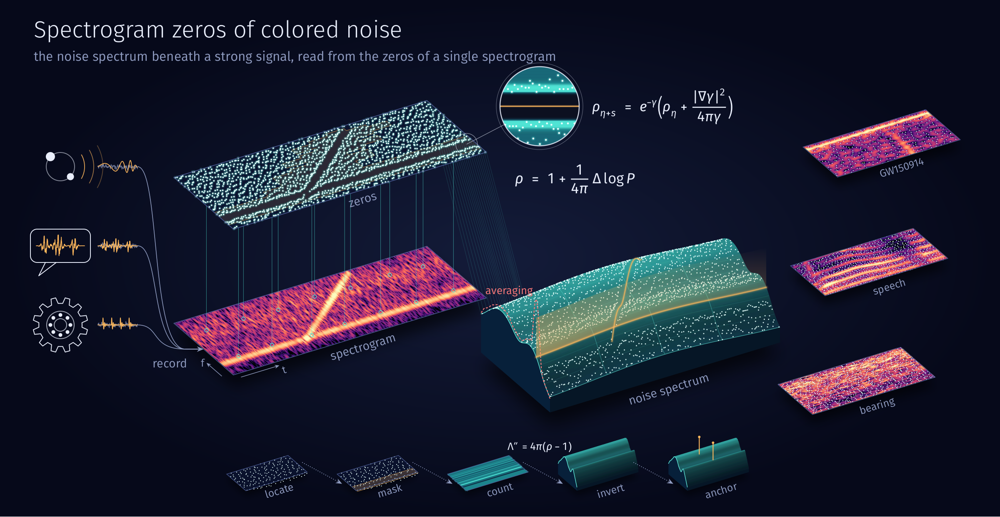
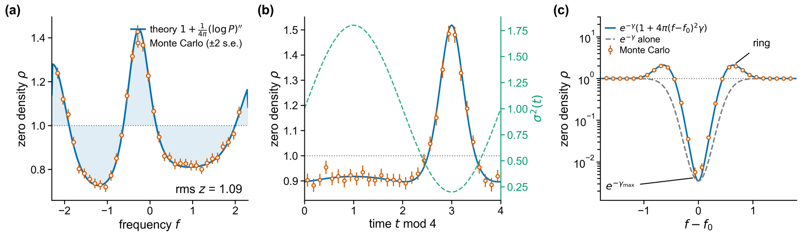
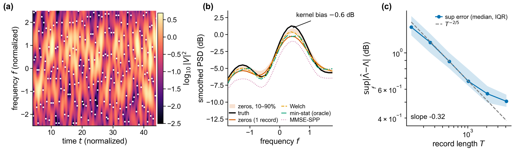
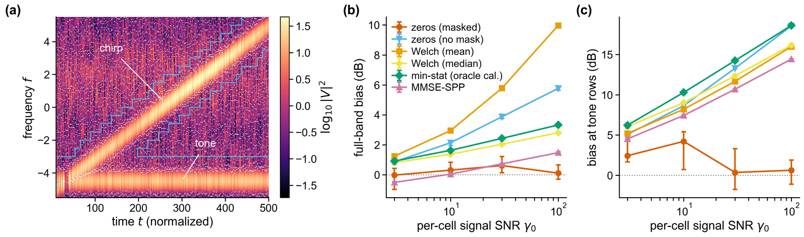
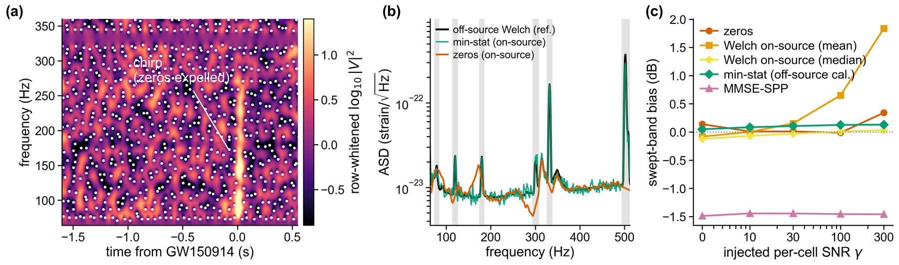
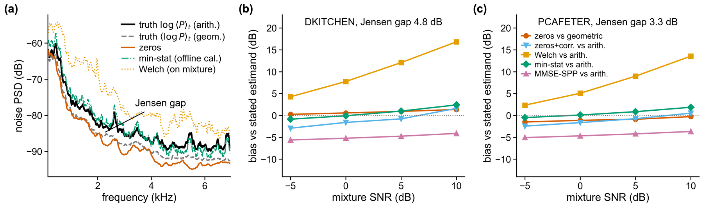

<h1 align="center">Spectrogram Zeros of Colored Noise</h1>

<p align="center"><b>Noise spectrum estimation from the zeros of a Gaussian-window spectrogram</b></p>

<p align="center">
  <a href="LICENSE"></a>
  
  
</p>

<p align="center">
  
</p>
<p align="center"><sub>Overview of the method. Records from gravitational-wave detectors, speech, and machines are signals riding on noise. The zeros of a record's spectrogram (lifted plane) form a point pattern whose density follows the noise spectrum; a strong signal expels the zeros from its track and leaves a ring of excess zeros around it (lens, Theorem 2), and the estimator masks those cells. The zero density maps onto the noise spectrum (Theorem 1), drawn as a landscape with the zeros lying on it: the tone stands on the landscape as a light curtain and the spectrum continues beneath it, while the dashed line on the front face is the spike that a time average of the spectrogram reads at the tone. Bottom: the five steps of Algorithm 1. Right: GW150914 strain, speech, and bearing vibration with their zeros.</sub></p>

This repository holds the code and the stored results of the paper *Spectrogram Zeros of Colored Noise: An Intensity Formula and Spectral Estimation Without Spectral Averaging*, submitted to the IEEE Transactions on Signal Processing. The stored results regenerate every figure of the paper and of its supplementary material (SM), and every experiment can be rerun from public data.

## The idea

Detection, denoising, and inference start from an estimate of the noise spectrum, and the hardest case is a strong signal in the same band as the noise. Welch, multitaper, minimum-statistics, and MMSE estimators average spectrogram values, so the energy of an in-band signal enters their estimates. This code reads the noise spectrum from where the spectrogram vanishes.

With a Gaussian window, the spectrogram zeros of any circular Gaussian noise, stationary or not, form a point process. Its density depends only on the expected spectrogram $P$:

```math
\rho(t,f) = 1 + \frac{1}{4\pi}\,\Delta \log P(t,f),
```

where $\Delta$ is the Laplacian in the time–frequency plane. A flat spectrum gives one zero per time–frequency cell, spectral peaks thin the zeros, and valleys crowd them. Counting the zeros and inverting this law recovers the window-smoothed noise spectrum: its shape comes from the zero locations alone, and two reference levels fix its scale. A strong deterministic signal suppresses the zero density exponentially in its local signal-to-noise ratio, so the cells it occupies are detected, masked, and bridged.

## Highlights

- **Exact intensity laws** for colored, nonstationary, and generalized Gaussian noise, white noise included, confirmed by Monte Carlo with no fitted parameter.
- **Clean noise:** within 0.3 dB of Welch and of oracle-calibrated minimum statistics, with a proved uniform rate.
- **Persistent in-band line:** value-based estimators report the line power as noise floor, by +14 to +19 dB; the zero estimate detects the line and bridges the floor beneath it to within +0.62 dB.
- **Measured data:** on-source LIGO strain around GW150914, continuous speech, and bearing vibration.

## Results

**Intensity laws.** Monte Carlo zero densities against the theory, with no fitted parameter: a stationary bimodal spectrum, modulated white noise, and white noise plus a tone.



**Clean colored noise.** One record with its zeros, the estimates of all methods on one record, and the sup-error against the record length.



**Strong in-band signals.** A sweeping chirp and a persistent tone at increasing SNR: one record with its mask, the full-band bias, and the bias at the tone rows.



**GW150914, on-source.** The zeros around the event, the zero estimate from the 64 s containing the event against the off-source Welch reference, and the bias under injected chirps.



**Continuous speech.** The arithmetic- and geometric-mean noise spectra under fluctuating noise, and the bias of each method against its own estimand in kitchen and cafeteria noise.



## Quick start

Python 3.12 or later. With [uv](https://docs.astral.sh/uv/):

```bash
git clone https://github.com/nbnrwfdk12138-hub/zerospec.git
cd zerospec
uv sync
uv run python scripts/smoke_test.py
```

Without uv, `pip install -e .` installs the package and its dependencies. The smoke test runs in a few seconds; it prints the zero density of white noise, which should be close to 1, and the estimation error on one colored-noise record.

Estimating a noise spectrum takes a few lines:

```python
import numpy as np
from zerospec import ZeroSpecEstimator, synth_stationary
from zerospec.theory import smoothed_psd

# colored test noise with a two-peak PSD, 256 window units long
S = lambda nu: (0.15 + 1.2 * np.exp(-(nu - 0.8) ** 2 / 0.5)
                + 0.7 * np.exp(-(nu + 1.0) ** 2 / 0.245))
T = 256.0
x = synth_stationary(S, T, np.random.default_rng(0))

# estimate the window-smoothed noise PSD from the zeros
r = ZeroSpecEstimator(band=(-1.8, 1.8), mask=True).fit(x, T)

err_db = 10 / np.log(10) * (r.Lambda - np.log(smoothed_psd(S, r.f)))
print(f"rms error {np.sqrt(np.mean(err_db ** 2)):.2f} dB")  # about 0.4 dB
```

`r.f` holds the analysis frequencies and `r.Lambda` the estimated log of the window-smoothed noise PSD. All quantities are in window-normalized units, with the unit Gaussian window g(t) = 2^(1/4) exp(-π t²), in which a time–frequency cell has unit area.

## Reproducing the paper

The stored results regenerate the figures without rerunning any experiment:

```bash
uv run python scripts/make_rows3_r1.py      # Figs. 1-5 of the paper
uv run python scripts/make_sm_panels_r1.py  # Figs. 6-9 of the SM
```

Both write PDF and PNG files to `figures/rows3_r1/`. Most numbers quoted in the paper are stored in the same `results/*.npz` files; [`REPRODUCE.md`](REPRODUCE.md) maps every figure and table to its scripts and marks the few numbers that a script prints instead.

<details>
<summary><b>Rerunning the experiments</b></summary>

<br>

Download the data first (about 2 GB in all):

```bash
uv run python scripts/download_data.py
```

This fetches the LIGO, LibriSpeech, and DEMAND data and unpacks the archives where the experiments read them. The Ottawa bearing data may have to be downloaded by hand from Mendeley Data (see [Data](#data)) and unpacked so that `data/ottawa/v43hmbwxpm-2/1 Data collected from a healthy bearing/H-A-1.mat` exists.

Then run the experiment scripts with `uv run python scripts/<script>`:

| Script | Paper |
|---|---|
| `run_e1_intensity.py` | Fig. 1 |
| `run_e2_estimator.py` | Fig. 2 |
| `run_e3_robustness.py` | Fig. 3 |
| `run_e3b_ligo.py` | Fig. 4 |
| `run_e3c_speech.py` | Fig. 5 |
| `run_e3c_enhance.py` | SM Table II |
| `run_e3d_bearing.py H-A-1`, then `run_e3d_bearing.py I-A-1` | SM Fig. 8 |
| `run_e4_ablations.py` | SM Figs. 6 and 7 |
| `run_e5_roc.py` | SM Sec. S-III-A (detection rates, runtime) |
| `run_s2_lattice.py` | SM Sec. S-II (zero lattice of two logons) |
| `run_s5_realnoise.py` | SM Fig. 9 |

On a desktop PC the runs take from about a minute (bearing) to about an hour (Fig. 3). Each script fixes its random seed; the seeds are also listed in SM Sec. S-IV. Rerunning reproduces the stored results up to floating-point differences between platforms and library versions.

</details>

## Repository layout

```text
src/zerospec/      the package
  core.py          Gaussian-window STFT and zero detector, rule (11) of the paper
  theory.py        intensity formulas
  estimator.py     the estimator of Algorithm 1
  baselines.py     Welch, minimum-statistics, and MMSE-SPP baselines
  figstyle.py      figure style
scripts/           run_*.py experiments and make_*.py figures
results/           stored results behind every figure and table
docs/              images on this page
REPRODUCE.md       which script produces which figure or table
```

## Data

The data are public and are not redistributed here.

| Dataset | Source | Used in |
|---|---|---|
| GW150914 strain, H1, 4 kHz | GWOSC, https://gwosc.org | Fig. 4 |
| LibriSpeech `test-clean` | https://www.openslr.org/12 | Fig. 5, SM Table II |
| DEMAND, environments DKITCHEN and PCAFETER | Zenodo, https://doi.org/10.5281/zenodo.1227121 | Fig. 5, SM Table II |
| University of Ottawa variable-speed bearing data | Mendeley Data, https://data.mendeley.com/datasets/v43hmbwxpm/2 | SM Fig. 8 |

## Citation

If you use this code, please cite the paper. The full reference will be added here on publication.

## License

The code is released under the MIT License (see [`LICENSE`](LICENSE)). The datasets keep the licenses of their providers.
